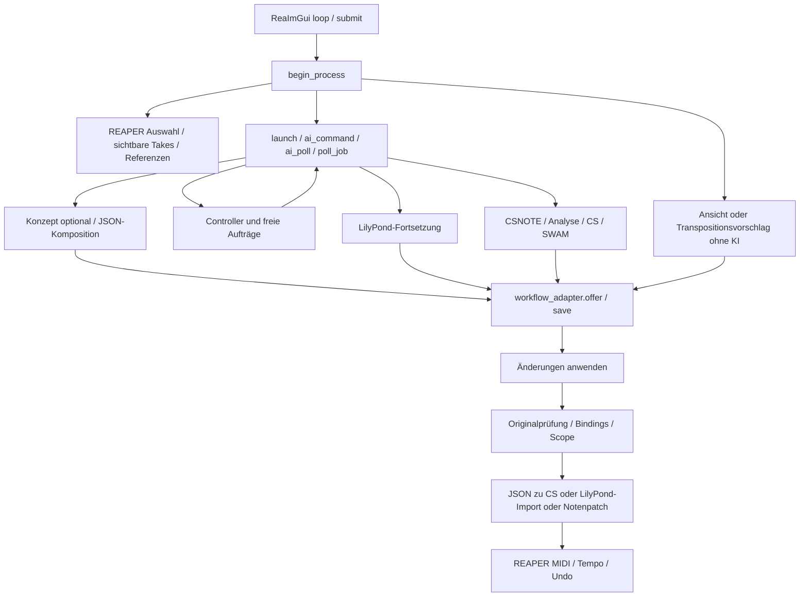

# Architektur-Audit und Modularisierungsplan

Stand: 05.11.2026. **Analyse und Planung, keine implementierte Modularisierung.**
Grundlage bleibt die [verbindliche Architekturvision](MODULAR-ARCHITECTURE-VISION.md).
Produktversion 1.1.10, musikalisches Verhalten, Updatekanal und Notationsarbeit bleiben unverändert.

## 1. Quellen, Methode und Evidenzgrenzen

Die folgenden GitHub-Stände wurden per HTTPS-Git gelesen; Studio wurde mit
`git fetch origin main` abgeglichen. Die Arbeitskopie war vor Beginn sauber.

| Quelle | Geprüfter Commit / Umfang |
| --- | --- |
| Composition-Studio main | `4743491d7081cf009f144a88b70c373047febeab`; `AGENTS.md`, vollständiger `PROJECT_STATE.md`, `README.md`, Architekturvision, Produktionsskript, Brücke, Installationsgeneratoren, Tests und CI |
| AI-Development-Standards | `514016cd60a8311e6bfd2489ce3bd4703685eedf`; `DEVELOPMENT_STANDARDS.md` und `AGENTS.md` vollständig |
| Composition-Engine main | `8b062ea6deea9e7421c62b0dd415cf652b47828a`; Einstiegshinweise, Projektstand, README, Architekturvertrag, Manifest, Runtime-APIs, Workflow-Kern/Generator und Regressionstest |

Quellbelege beziehen sich auf diese Commits, nicht auf künftig verschobene Branchspitzen:
[Studio](https://github.com/wibem1/Composition-Studio/blob/4743491d7081cf009f144a88b70c373047febeab/Composition%20Studio.lua),
[Engine](https://github.com/wibem1/Composition-Engine/blob/8b062ea6deea9e7421c62b0dd415cf652b47828a/composition-engine.js),
[Standards](https://github.com/wibem1/AI-Development-Standards/tree/514016cd60a8311e6bfd2489ce3bd4703685eedf).

Der Audit untersucht den produktiven Studio-Pfad, nicht die experimentellen
Notationsbranches. PR #12 wurde weder ausgecheckt noch verändert. Eine lesende
GitHub-API-Abfrage wurde mit `Forbidden` abgewiesen; daher werden hier keine neu
verifizierten Aussagen über dessen aktuellen Head, Status oder CI gemacht.
Die Engine wurde nur in einer temporären Lesekopie geprüft und nicht verändert.
Es gab keine bezahlten Provideraufrufe, keine ausgelösten Actions und keinen Release.

## 2. Tatsächlicher Bestand

`Composition Studio.lua` hat 2610 Zeilen, darunter extrem lange Funktionszeilen.
Es enthält nicht nur Musiklogik, sondern Start/Autostart, UI, Dateisystem,
Providertransport, Kostenrechnung, Auftragssteuerung, Auswahl, Änderungsprüfung,
MIDI-Schreiben, Export und Updates in einem lexikalischen Lua-Kontext.
Die Dateigröße allein ist kein geeignetes Maß für eine sichere Extraktionsgrenze.
Das [Funktionsinventar](MODULARIZATION-FUNCTION-INVENTORY-2026-11-05.md)
ordnet die benannten Funktionsdefinitionen mit Quellzeile zu.

### Verantwortlichkeiten und konkrete Extraktionsgruppen

Zeilenangaben gelten für die oben fixierte Studio-Basis. Die Namen sind vorhandene
Funktionen; Modulpfade sind Vorschläge für spätere Entwicklungsquellen.

| Zielbereich / vorgeschlagener Pfad | Vorhandene Funktionen / Quellbereich | Verantwortung und Abhängigkeiten |
| --- | --- | --- |
| Core `src/core/bootstrap.lua` | `ensure_native_startup_hook`, `remember_closed`, `check_project_change`, `loop` (62–93, 2549–2610) | Start, Lebenszyklus, Projektwechsel; REAPER und UI injizieren; Start schreibt bereits ExtState und `Scripts/__startup.lua` |
| Core `src/core/version.lua` | `version_parts`, `version_is_newer` (179–194) | Reiner Versionsvergleich; keine Host-/Musik-/Providerabhängigkeit |
| Host Bridge `src/host/reaper/context.lua` | GUID-Helfer, `selected_tracks`, `focused_or_last_notation_editor`, `notation_selection_items`, `notation_visible_items`, `selected_items`, `track_context_items`, `time_selection_context`, `score_context_tracks` (476–691) | Native Handles und PPQ/QN/Seconds; Sichtbarkeit, Editierbarkeit, Auswahl getrennt erfassen |
| Host Bridge `src/host/reaper/commit.lua` | `execute_action`, `create_track`, `existing_program`, `create_midi`, schreibender Teil `apply_composition`, `apply_notation_patch`, `apply_notation_transpose` (725–744, 1745–1911) | Ausschließlich Host-Schreibzugriff, erneute Quellprüfung, Undo/Rollback; UI darf ihn nicht umgehen |
| Host Bridge `src/host/reaper/instruments.lua` | `first_program_changes_on_track`, `find_halions`, `halion_program_param`, `source_tracks_for_halion`, `initialize_halion_track/project` (696–705) | HALion-FX-/Routingadapter; `program_for_name` getrennt als bestehende Instrumentzuordnung bewahren |
| Host Bridge `src/host/reaper/workspace.lua` | `open_score_workspace` (2127–2181) | Bestehende native Piano-Roll/Notation-Aktionen und registrierten Shortcut aufrufen; keine Übernahme aus PR #12 |
| UI `src/ui/reaper.lua` | Font-, Clipboard-, Kontextmenü-, `fit_label`, `draw_model_picker`, `draw_workflow_status`, `draw_history`, UI-Teil `loop` (94–99, 2442–2610) | ReaImGui, Darstellung und Eingabe; Statusdaten lesen, Aufträge an Workflow senden |
| AI Interface `src/ai/providers.lua` | `reasoning_parameters`, `ai_command`, `ai_poll`, `response_text`, `first_text_field`, `read_json_string`, `utf8` (306–309, 468, 1039–1116) | Providerformat und Antwort-/Usage-Verarbeitung; Transport, Uhr, Credentials und Diagnose als Dienste |
| AI Interface `src/ai/catalog.lua` | `workflow_adapter.models.parse/page/refresh/poll/report`, Modellregister, `select_model`, `get_key`, `edit_key` | Modellmetadaten von UI, sicherem Credentialzugang und ExtState-Speicherung trennen; keine automatische Katalogabfrage |
| AI Interface `src/ai/costs.lua` | `costs.usage/rate/price/begin/start/record/text/amount/edit_rate/show` (852–1029) | Usage und Tarifrechnung portabel; Uhr/Tarife/Persistenz/UI injizieren; Schätzung, kein hartes Budgetlimit |
| Plattform `src/platform/process.lua` | `shell_quote`, `ps_quote`, `temp_path`, `ps_launch`, `windows_curl_script`, `unix_launch_script` (111–175) | Windows/Unix-Prozesse und temporäre Dateien; nicht in musikalischen Modulen |
| Infrastruktur `src/platform/storage.lua` | `read_file`, `write_file`, `enc`, `dec`, Chat-History und sichere Dateioperationen | Dateisystem und Hostpersistenz hinter getrennten Ports; heutige Namen/Backups bewahren |
| Diagnostics `src/diagnostics.lua` | `diag_json`, `persist_diag`, `diag_set`, `restore_diag`, `log_communication`, `save_diagnosis` (314–338, 379–382, 1117–1121) | Stufen, gesendete Prompts, Usage und Fehler nachvollziehbar halten; keine Schlüssel in Modulnachrichten |
| Distribution `src/distribution/update.lua` | `fetch_update`, `install_update`, `complete_update`, `poll_update` (197–304), Repair/Updater/Offline-Installer | Bestehender Ein-Datei-Update-/Backup-/Neustartvertrag; Generatoren konsumieren heute Quelltextabschnitte |
| Music Model `src/music/legacy_score.lua` | `decode_engine_json`, `engine_translate_json`, `parse_notes`, parsende Teile `apply_composition`, `workflow_adapter.encode` (726, 731–744, 1457–1596, 1609–1615) | Bestehende JSON-, CS-, CSMETA-, CSCTRL- und CSNOTE-Verträge isolieren; noch kein vollständiges Werkmodell |
| Music Analysis `src/music/analysis.lua` | `analysis_prompt`, `compact_context`, `music_context`, `compact_music_excerpt`, `editor_reference_excerpt` | Heute Prompt-/Kontextbildung, keine lokale Harmonie-/Motiv-/Formanalyse; Hostdaten vorab erfassen |
| Composition `src/music/composition.lua` | `engine_json_prompt`, `concept_prompt`, `composed_json_prompt`, `composition_prompt`, `lily_composition_prompt`, `continuation_prompt` | Bestehende Prompts unverändert auslagern; Engine-Ablauf nicht nebenbei ersetzen |
| Editing `src/music/editing.lua` | `parse_action`, `notation_patch_prompt`, Vorprüfung/Operationsplanung aus `apply_notation_patch/transpose` | Parse/Validierung von Commit trennen; Autorisierung und Kollisionsprüfung erhalten |
| Workflow `src/workflow/service.lua` | `begin_process`, `poll_job`, `launch`, `launch_new_json`, `begin_continuation`, `submit`, `workflow_adapter.offer/apply/review/transition` | Koordination und Status; explizite Abhängigkeiten auf AI, Modelladapter, Store und Host |
| Workflow `src/workflow/proposals.lua` | `workflow_adapter.history_path/save/load_unchecked/load/bindings/guard`, `save_history/load_history`, `recent_dialog` | Vorschläge/Analysen/Originalschutz von Chat und künftigem Music Memory unterscheiden |
| Shared Workflow | `create_workflow_core`, `core.check/advance/prompt/readable` (6–43) | Bereits geteilter Engine-Vertrag; keine unabhängige zweite Spezifikation schaffen |
| Performance / Export `src/music/performance.lua`, `src/host/reaper/export.lua` | `swam_source_context`, SWAM-Prompts, `begin_swam_interpretation`, `export_swam_midi`, `be16/be32/vlq/midi_track_chunk`, `write_last_midi_to`, `recover_last_made`, Speicherdialoge | SWAM-Aufführung von Komposition trennen; SMF-Erzeugung ist technisch, native Datenaufnahme/Dateidialog hostabhängig |
| Legacy-Übersetzung innerhalb Composition | `midi_translation_prompt`, `numbered_measure_count`, `chunk_prompt`, `check_translation_chunk`, `start_translation_chunk` (776–850) | Historische mehrstufige CS-Übersetzung samt Retry/Coverage erhalten, Erreichbarkeit separat charakterisieren |

**Noch nicht als eigenständige Fähigkeiten vorhanden:** Music Memory mit Motiv-/
Abschnittsidentitäten, lokales werkübergreifendes Music Analysis, Arrangement mit
strukturiertem Rollenmodell, Quality Review als begrenzter Gesamtprozess, Musical
Form & Development und Song Construction. Chat/Ergebnisverlauf ersetzt diese
Module nicht. Arrangement ist heute teilweise in freien Provideraufträgen und
Spur-/Programmlogik enthalten. Diese Zukunftsmodule werden nicht durch leere
Dateien oder ein neues Framework vorgetäuscht.

### Laufzeitabhängigkeiten

Erforderlich für die Anwendung: REAPER mit Lua 5.4 und ReaImGui; Dateizugriff im
REAPER-Ressourcenverzeichnis. KI-Funktionen brauchen bewusst konfigurierte
Providerzugänge. Unix nutzt `/usr/bin/curl`, teils `/bin/sh`/`os.execute`;
Windows nutzt System-PowerShell/.NET. Speicherdialoge verwenden Windows Forms
oder macOS `osascript`: Linux ist damit keine belegte vollständige Zielplattform.
LilyPond-Fortsetzung ist im Code ausdrücklich Windows-only und benötigt ein
konfiguriertes `lilypond.exe`. HALion und SWAM sind optionale Instrumentpfade.
Node.js ist für die Standard-REAPER-Laufzeit **nicht** erforderlich.

Entwicklungstests: Python 3.12, `lupa==2.8` mit `lupa.lua54`,
`imgui-bundle==1.93.0` gemäß CI; Lua-Tests können im Lua-5.4-Interpreter laufen.
Historische Git-Objekte sind für Installer-/Updatertests erforderlich. Es gibt
keinen zentralen Paket-Lock für die gesamte Entwicklungsumgebung.

## 3. Bestehende Aufrufketten und Kopplungen

Wichtige Ausnahme: `poll_job` führt zulässige Controller-`ACTION|` über
`parse_action → execute_action` **sofort** aus. Das ist nicht derselbe Ablauf wie
gespeicherte Kompositionsvorschläge; bei Notenauswahl und read-only Editorscope
sind Whole-Item-Aktionen gesperrt. Eine Zentralisierung darf diese vorhandenen
unterschiedlichen Freigabewege nicht unbemerkt ändern.

Die heutigen Abhängigkeiten sind überwiegend Closure-Zugriffe: `busy`, `job`,
`provider/model`, `last_diag`, `last_made`, `history`, `current_project`,
`composition_mode`, `workflow_adapter`, `costs`, UI-Kontext und globale `reaper`-
Aufrufe. Vorwärtsdeklarierte Funktionen (`launch`, Export, Diagnose, Titel)
verbinden weit entfernte Abschnitte. `workflow_adapter` bündelt zudem Store,
Hostschutz, Auftragssteuerung und Modellkatalog. Nur Dateiabschnitte zu verschieben
würde diese Kopplung nicht lösen.

**Zielrichtung:** UI → Workflow → musikalische Dienste / AI / ProposalStore →
Host-Ports; reine Musikdaten und Validierer dürfen weder REAPER-Handles noch UI,
Prozesse, Dateipfade oder Provider-Schlüssel benötigen. Der Bootstrap verdrahtet
Adapter. Host-Commit bleibt die einzige Schreibgrenze. Kein zyklischer Import
zwischen UI, musikalischem Kern und Host; Diagnose wird als Callback injiziert.

## 4. Schnittstellen: klein beginnen, Verträge ausdrücklich versionieren

Die folgenden Verträge sind **Entwurf**, keine vorhandenen APIs. Zunächst nur
Felder der bestehenden Pfade abbilden; keine Musik quantisieren oder ergänzen.

| Port / Datentyp | Eingabe → Ausgabe / Fehler | Verbindliche Invarianten |
| --- | --- | --- |
| `HostContext.capture(scope)` | Scope `items`, `selected_notes` oder `visible_editor` → Snapshot + opake Hostbindung; Fehler bei ungültigem Editor/Übergröße | Ziel und read-only Referenz getrennt; kein stiller Fallback von Noten auf Items |
| `MusicSnapshot` v1 | Stimmen mit stabiler ID, Noten-ID, `start_qn`, `duration_qn`, Pitch, Velocity, Kanal, Programm, Tempo-/Takt-/CC-Daten | QN = Viertel, globaler Ursprung explizit; PPQ/Seconds nur Adapter; musikalische Stimme ≠ automatisch Track |
| `HostBinding` v1 | Projektidentität, Item-/Track-GUID, Note-Index und originale PPQ-/Kanal-/Pitch-/Velocity-Referenzen | Handles bleiben lokal und werden neu validiert; Notenindex ist keine dauerhafte musikalische Identität |
| `LegacyScore.decode/translate` | Antworttext → bestehende CS-Zeilen oder bestehender Fehler | Bestehende Defaults, Reihenfolge, Rundung auf sechs Dezimalstellen und Ablehnungen charakterisieren; keine neue Reparaturpolitik |
| `AI.start/poll` | Auftrag mit Stage, Prompt, Provider/Modell-/Reasoning-Snapshot und geschütztem Credentialverweis → ausstehend / Antwort / Fehler + Usage | Keine echten Schlüssel in serialisierten Aufträgen; verbrauchte, aber fehlgeschlagene Calls bleiben kostenmäßig unbekannt/erfasst |
| `Workflow.propose/review/apply` | eingefrorener Kontext + Antwort → Vorschlag / Analyse / Fehler; explizite Anwendung → Commitresultat | Originalprüfung vor Schreiben; Projektwechsel verwirft Job; doppeltes Apply verboten |
| `ProposalStore.save/load` | bestehende Records mit Format, Coreversion, Raw/Payload, Bindings, Sourceguard, Scope, Provider/Modell → dauerhaftes Ergebnis | Alte `WorkflowHistoryV1`/Dateibackups weiter lesbar; API-Schlüssel ausgeschlossen; Fehler nicht als Erfolg melden |
| `Editing.validate` | Vorschlag + erneut gelesene Quelle → vollständiger Operationsplan oder Fehler | CSNOTE exakt vollständig/eindeutig; nur Pitch/Velocity; unmarkierte Noten, Timing und CC unverändert |
| `HostCommit.apply` | validierter Plan + erwarteter Sourceguard → geänderte IDs / Fehler mit Rollbackstatus | Ein Undo-Block des betreffenden Vorgangs; keine Teilübernahme; bestehende Tempo-/Quellschutzregeln bewahren |
| `Diagnostics.record` | Stage, Request-ID, Metadaten, redigierte Nutzdaten → Ereignis/Fehler | Tatsächlich gesendete Prompts und Kostenstatus erhalten; keine impliziten neuen API-Aufrufe |

Der aktuelle `source_guard` ist ein großer Vergleichstext aus Tracknamen/GUIDs,
Item-Chunks und Tempo-/Taktkarte, **kein Hash** und kein vollständiger Snapshot
aller FX-/Routingzustände. Diese Semantik zunächst erhalten und ihre Grenze
dokumentieren; nicht bei der Extraktion durch einen vermeintlich gleichwertigen
Kurz-Hash oder nur Notenvergleich ersetzen.

Später muss Music Model zwischen gemeinter musikalischer Struktur, Notation und
expressiver Performance unterscheiden. Motive, Phrasen, Formbeziehungen und
Interpretationsunsicherheit sind Erweiterungen, keine heute aus MIDI zuverlässig
rekonstruierbaren Tatsachen. Unbekannte/hostnative Informationen verlustfrei im
Adapter bzw. als explizit opaque Daten erhalten; Verlust muss sichtbar werden.
MuseScore- und Maestro-Adapter brauchen zuerst dieselben Daten-/Testverträge,
nicht zwingend denselben Lua-Binärcode.

## 5. Composition Engine: vorhandene Wiederverwendung und Integrationsgrenze

### Zwei unterschiedliche Bestände

1. **Bereits verwendet:** Studio enthält `create_workflow_core` und die eingebettete
   Spezifikation `Composition-Workflow-1` v1.0.0. Ein struktureller Vergleich mit
   Engine `workflow-core/spec.json` ergab Gleichheit. Der Lua-Interpreter ist nach
   Entfernen des führenden Kommentars ebenfalls identisch (siehe Prüfprotokoll).
   Regeln/Transitions/Prompts bleiben dort zentral; keine zweite Studio-Regelsammlung.
2. **Nicht im Standardpfad ausgeführt:** `composition-engine.js`. Studio liest
   JSON direkt in Lua und übersetzt nach CS. `engine-bridge.js` ist eine
   Entwicklungsreferenz (`docs/ENGINE-BRIDGE.md`), keine laufende Runtimekopplung.
   Der Kommentar über Engine-/Bridge-Downloads bei Studio-Zeile 1354 beschreibt
   daher nicht den tatsächlich aktiven Ablauf.

### Tatsächliche Engine-APIs und Unterschiede

Die Runtime exportiert `window.CompositionEngine` (kein normales CommonJS-Modul)
mit Version **2.20.1**, Build **22001**. Relevante APIs:

| API | Bestehender Vertrag / Integrationsnutzen |
| --- | --- |
| `compose({snapshot,key,runId,now,requestModel,...})` | asynchron → `{run,midiBytes}`; Provideraufrufe über injiziertes `requestModel`; kein REAPER-Commit |
| `analyzeScore`, `analyzeImprovement` | Score + Snapshot/Callback → Assessment/Prompt; keine Hoständerung |
| `improveScore` | Score + freigegebenes Assessment → neuer Score, MIDI, Raw/Prompt; Freigabe und Originalschutz bleiben Hostaufgabe |
| `extractJson`, `findScore`, `parseCompositionRepresentation` | JSON/kompakt/ABC/MIDI-Performance → Engine-Score; Validierung/Normalisierung ist nicht gleich Studio |
| `buildMidi`, `playbackScore`, `performanceSnapshot`, `expressionAudit` | technische Performance-/Exportfunktionen; Ersatz nur nach nachgewiesener Ereignisparität |
| `createPrompts`, Request-/Exporthelfer | zentrale Prompt-/Provider-/Formatlogik prüfen, statt in Studio neu zu erfinden |

Engine `findScore` versteht zusätzlich kompakte `{t,b,m,v}`-Daten und
H/V/B-Zeilen über den Parser. Engine `tempoEvents` und Track-`cc` sind Arrays
(`[at,bpm]`, `[at,controller,value]`); Studio verwendet Objekte
`{at,bpm}`, `ccEvents:{at,controller,value}` und gemeinsame `pedalEvents`.
Engine unterstützt zusätzlich Pitch Bend und symbolische Ausdrucksinformationen.
Studios Lua-Adapter ist daher kein vollständiger Engine-2.20.1-Adapter.
Die Node-Brücke überträgt nur einen Teil (Noten/Anfangstempo/-takt), nicht die
heutigen gesamten Ausdrucksdaten. Ihr `vm` ist keine Sicherheitsgrenze für fremden Code.

**Versions-/Vertragsdrift:** Studio meldet je nach Pfad Engine 2.3.2/232 oder
JSON bridge 2.20.1/22001. Engine-README nennt 2.4.0, Manifest 2.12.0/test;
Runtime und Regressionstest nennen 2.20.1. Der Architekturvertrag verbietet eine
zweite KI-Übersetzung, die aktuelle Runtime nutzt für compact/ABC/MIDI hingegen
`musical_composition → technical_realization → composition_analysis_afterwards`.
`free` liefert nur Quelltext und `midiBytes:null`; LilyPond liefert in einem Call
zwei Darstellungen und baut MIDI aus dem Performance-Abschnitt. Studio startet
bei fehlender Einstellung mit `composition_mode="concept"`, also einem
vorgeschalteten Rahmen. **Keine dieser Varianten darf aus einer Versionsnummer
allein als kompatibel oder musikalisch freigegeben abgeleitet werden.**

### Konkrete Integration ohne Duplizierung

Zuerst den bereits gemeinsamen Workflow-Kern mit Herkunftscommit und
Paritätsprüfung sichern. `workflow-core/build.py` nicht ungeprüft ausführen: Es
bearbeitet auch MuseScore-Dateien und erzeugt weitere Engine-Dateien; sein
Standardlayout passt nicht zu diesem Checkout. Ein späterer Studio-Build darf
nur Studio-Ausgaben erzeugen und muss zentralen Kern unverändert einbetten.

Danach einen schmalen Engine-Kompatibilitätsport vorsehen:
`capabilities/version → normalizeScore → analyze/compose/improve`.
Er soll freigegebene Engine-Fähigkeiten delegieren oder ausdrücklich versioniert
lokal spiegeln, nicht eine konkurrierende musikalische Engine entwickeln.
REAPER-Auswahl, Persistenz, Instrumente, Vorschläge und Undo bleiben bei Studio.
Vor einer tatsächlichen Runtimeanbindung braucht es einen eigenen Auftrag mit
geklärtem Referenzvertrag, Laufzeit-/Paketentscheidung und Paritätstests.
Node als neue Pflichtinstallation oder ein Engine-Upgrade wären keine rein
verhaltenserhaltende Extraktion. Keine Engine-Quelle wird in diesem Auftrag geändert.

## 6. Risiken und bestätigte Befunde

| Priorität | Befund / Risiko | Konsequenz für nächste Arbeit |
| --- | --- | --- |
| Hoch | Lexikalisches `local function utf8(cp)` (306) verdeckt Lua-Standardtabelle; `decode_engine_json` ruft `utf8.char(cp)` (1485) auf | Reproduktion mit beiden Produktionsabschnitten: `{"title":"\u00e4"}` scheitert mit `attempt to index a function value`; literales `ä` besteht. Separater Fehlerauftrag, keine stille Reparatur bei Extraktion |
| Hoch | Tests schneiden Produktionsfunktionen mit Stringmarkern heraus und stellen Umgebung neu zusammen | Bestehender JSON-Test sieht die verdeckende `utf8`-Funktion nicht; künftige Modultests plus Tests des tatsächlich gebauten Gesamtartefakts erforderlich |
| Hoch | Einzeldatei-Updater installiert nur `Composition Studio.lua`; Offline-Installer enthält deren Bytes | Lose neue Runtime-Dateien würden Installation/Repair/Rollback brechen; Entwicklungsquellen modular, ausgeliefertes Artefakt zunächst weiterhin eine Datei |
| Hoch | `tools/test_model_transport.py` startet mit leerem `saved`, während `models.refresh` Schlüssel aus ExtState verlangt | Test scheitert vor dem ersten HTTP-Request: Status „Für OpenAI fehlt der API-Key“. Bestätigter Fixturefehler; Testquelle hier unverändert, Transportfunktion damit nicht als bestanden behaupten |
| Hoch | Scope, Originalprüfung, Persistenz und Undo sitzen in verschiedenen Funktionen | Noten-/Editorreferenzen niemals als Schreibfreigabe interpretieren; Stale-/Projektwechsel-/Rollbacktests vor Hostextraktion |
| Hoch | Engine-/Studio-Verträge und Versionen divergieren | Integration als getrennte Entscheidung; keine Prompt-, Default- oder Formatangleichung im Refactoring |
| Mittel | `apply_composition` vermischt Parser, Namens-/Programmheuristik, Tempoersatz und Commit | Zuerst Resultate charakterisieren; geänderte Instrument-/Map-Reihenfolge kann hörbares Verhalten ändern |
| Mittel | Legacy-Chunk-Pfad rechnet Coverage mit vier QN je Takt und fordert Noten in jedem Takt | Pausentakte/andere Taktarten sind problematisch; Erreichbarkeit und Verhalten separat prüfen, nicht beiläufig normalisieren |
| Mittel | Teilweise Vorwärtsdeklarationen und historisch verbliebene Job-Stages | Keine Löschung nach Namenssuche; tatsächliche Dispatchwege testen, Callback-/Projektbindung explizit machen |
| Mittel | Windows-/macOS-Prozesse, Linux-Dialoggrenze, Windows-only LilyPond | Cloud-Mocks belegen keine native Plattformfreigabe; einen gebündelten REAPER-Praxistest vor Produktfreigabe vorsehen |
| Mittel | Projekt-ID/History/Backups, Diagnosecache, `LastMadeGUIDs`, Kosten-/Modelleinstellungen sind dauerhaft | Keine Schlüsselumbenennung/Schema-Migration im ersten Refactoring; Reload/Backup/Altstände testen |
| Mittel | Providerkeys werden aus REAPER ExtState gelesen; Prozesse/temporäre Skripte unterscheiden sich je Pfad | Credential-Port und Bereinigung separat prüfen; nie Schlüssel in Music Model, Vorschläge oder gespeicherte Setupanweisungen kopieren |
| Mittel | Kostenanzeige hat keine harte Budget-/Schleifengarantie | Zukunfts-Workflow benötigt eigene Limits/Abbruchverträge; im Audit keine Zusatzcalls oder automatische Qualitätszyklen |
| Offen | Kein vollständig belegter realer REAPER-/Provider-/Hörvergleich für diese Gesamtversion | Technische Simulation und Engine-Regressionslauf sind keine musikalische oder Produktfreigabe |

## 7. Vorhandene Tests und tatsächlich ausgeführte Prüfung

Aktuelle Cloud-Prüfung: Python 3.12.14, Lua 5.4 via `lupa==2.8`,
`imgui-bundle==1.93.0`, Node 24.22.1. Alle Testquellen blieben unverändert.

| Suite / Befehl | Ergebnis dieses Audits | Nutzen / Grenze |
| --- | --- | --- |
| `python tools/test_cost_accounting.py` | bestanden, 32 Kostenprüfungen | Usage, Snapshots, unbekannte Kosten, Persistenz; keine Anbieterrechnung |
| `python tools/test_reasoning.py` | bestanden, 28 Provider/Mode-Fixtures, führt auch Kostenprüfungen aus | Native Requestparameter, Busy/Restart/Diagnose; nicht doppelt als unabhängige Kostenfälle zählen |
| `python tools/test_layout.py` | bestanden, 64 Dear-ImGui-Layouts | Echte ImGui-Geometrie, REAPER-Aufrufe simuliert |
| `python tools/test_model_picker.py` | bestanden, 6 ImGui-Interaktionen plus Katalog-/Argonchecks | Identität, Provider, Persistenz, kein automatisches Netz |
| `python tools/test_lilypond_import.py` | bestanden, Runner meldet 33 Prüfungen; echter Compiler ausdrücklich SKIP | Vollsyntax, erster Startframe, Import/Undo/Update/Rollback unter Mocks |
| `python tools/test_text_workflow.py` | bestanden | Routing, Fortsetzung, Übergänge, Controllerantworten, keine echten KI-Aufrufe |
| `python tools/test_workflow_core.py` | bestanden | Vorschlag ohne Schreiben, Originalschutz, Save/Reload, Review, Übergang, JSON-Ausdruck/Katalog |
| `python tools/test_update_helper.py` | bestanden | Unix-/Windows-Transportmocks, 1.1.7→aktuell, exakte Backups |
| `python tools/test_offline_installer.py` | bestanden, 7 historische Startstände + 7 Schutzfälle | Ausgelieferte Payload und Originalerhalt, kein echter Menü-/Neustarttest |
| `python tools/test_model_transport.py` | fehlgeschlagen, Fixturedefekt wie oben | Zunächst Socketverbot der Sandbox, außerhalb erneut ausgeführt; danach 0 HTTP-Requests wegen fehlender Fixturekeys |
| Drei Dateien `tests/*.lua` | alle bestanden, jeweils neuer Lua-5.4-Kontext via lupa | JSON-Brücke/Wiring, ausgewählte Noten/KI-Patch, sichtbarer Editorscope/Referenz/Review; Host simuliert |
| Engine `node tests/engine-regression.test.js` | bestanden, 10 benannte OK-Gruppen | Parser, Ausdruck, Exporte, Playback, Callback-Komposition ohne Liveprovider; Engine nicht verändert |
| Eingebetteter Workflow vs. Engine | Spezifikation strukturell gleich; Interpreter nach Kommentarabgrenzung gleich | Herkunft gesichert, keine automatische Aktualisierung |
| Audit-Reproduktion Unicode | erwarteter Fehler reproduziert; literales Unicode besteht | Beleg eines Bestandsfehlers, kein grüner Regressionstest |

Damit: **9 von 10 Studio-Python-Suiten bestanden**, eine diagnostiziert
fehlgeschlagen; drei Lua-Dateien und Engine-Regressionsrunner bestanden.
Die Compilerprüfung ist ausgelassen, nicht bestanden. Es wurden keine neuen
permanenten Tests hinzugefügt, weil dieser Auftrag nur Dokumentation liefert.

Nicht ausgeführt: realer REAPER-Start/-Neustart, native Windows-/macOS-Interaktion,
echter LilyPond-Compiler, Liveprovider, Hörtest, vollständige Drei-Host-Integration.
Engine `workflow-core/test_core.py` setzt zusätzlich PySide6 und ein benachbartes
MuseScore-/Reaper-Layout voraus und wurde nicht als dreisprachige Gesamtsuite
ausgeführt. Ein zukünftiger dokumentierter Runner muss Setup und Bestandsfehler
von eigentlichen Regressionen unterscheiden.

CI deckt diese Gesamtheit nicht ab: Die bestehenden Workflows haben Quell-/
Testpfadfilter und führen nur Teilmengen aus; ein reiner Dokumentations-PR kann
daher ohne diese Jobs bleiben. Keine künstliche Quelländerung zum CI-Auslösen.

## 8. Reihenfolge und objektive Zwischenziele

| Schritt | Begrenzter Umfang | Objektives Abnahmekriterium |
| --- | --- | --- |
| M0 – dieser Auftrag | Audit, Inventar, Projektstand auf Dokumentationsbranch | Nur Markdowndiff; Produktionsblob/Installer/Engine unverändert; Prüfungen und Grenzen dokumentiert; PR zur Prüfung, kein Merge |
| M1 – erster Folgeauftrag | Nur Versionsvergleich als internes Modul extrahieren, siehe unten | Alten/neuen Comparator differentiell prüfen; Einzeldatei und beide Installerpfade funktionieren; keinerlei musikalische Prompt-/Ereignisänderung |
| M2 – unabhängige Fehlerabsicherung | Transport-Fixture und Unicode-Scope getrennt charakterisieren/beheben, jeweils eigener überschaubarer Auftrag | Transport erreicht fünf lokale Seiten mit Fixtureauth und prüft Fehlerfälle; escaped/literales Unicode im gebauten Gesamtskript; bestehende grüne Suiten bleiben grün |
| M3 – technische Formatgrenzen | JSON/CS-Parser/Encoder und reine Validierung isolieren | Gültige/ungültige Altfixtures liefern gleiche Ergebnisse/Fehler; Tempo/CC/Pedal/Kanäle/Rundung erhalten; keine Hostwrites in Parsern |
| M4 – Infrastrukturports | AI/Transport/Kosten/Diagnose/Store nacheinander, nicht in einem Großumbau | Gleiche gesendete Requestbytes bei eingefrorener Zeit/Konfiguration; Usage-/Fehler-/Cleanup-/Reloadverhalten gleich; keine echten API-Kosten für Regression |
| M5 – Host Bridge und Workflow | Kontextaufnahme, reine Operationsplanung und Commit schrittweise trennen | Notenselektion ≠ read-only Referenz; stale/missing Quelle/Projektwechsel blockiert; Fehler rollt vollständig zurück; alter Verlauf ladbar; native Gegenprüfung an Projektkopie |
| M6 – Enginevertrag / Music Model | Vorhandene Enginefähigkeiten und kanonische Minimaldaten nach eigener Entscheidung anbinden | versionierte Fixtures für JSON/CS/Engine-Arrays, Tempo/CC/Pitch-Bend-Verlust explizit; freigegebener Vertrag und keine zweite musikalische Engine |
| M7 – spätere Fähigkeiten | Music Memory → übergreifende Analyse/Arrangement → Workflow/Quality Review → Form & Development → Song Construction | Je Auftrag prüfbare Teilfunktion mit Werkbezug, Quellschutz, Kosten-/Abbruchgrenze und musikalischer Abnahme; keine feste Songform/Komplexität erzwingen |

M6 darf nicht unbemerkt zu einem Engine-Upgrade innerhalb M1–M5 werden.
Notation bleibt zurückgestellt; nur bestehende Workspace-Aufrufe werden erhalten.
Vor einer Produktfreigabe ein vorbereiteter, gebündelter REAPER-Vergleich:
gleiche Projektkopie, Note-/CC-/Tempovergleich vor/nach Apply und Undo,
Projektwechsel, Reload und bestehender Update-/Rückfallweg. Mocks ersetzen das nicht.

### Erster kleiner Refactoring-Schritt: interner Versionsvergleich

**Nach gesondertem Entwicklungsauftrag**, nicht in diesem PR:

- Nur `version_parts` und `version_is_newer` (179–194) als
  `src/core/version.lua` mit `parts(v)` / `is_newer(remote,localv)` isolieren.
  Keine Host- und keine Musikabhängigkeit; bestehende SemVer-/`x.y-testN`-
  Semantik einschließlich Fehlerfällen unverändert lassen.
- Modul als Factory/privater Block in die weiterhin einzige ausgelieferte Datei
  einbetten. Keine Runtime-`require`-Suche und keine zweite Installationsdatei.
  Die bestehenden lokalen Funktionsnamen als kompatible Bindung erhalten, bis
  konsumierende Generatoren und Tests bewusst umgestellt sind.
- Generatorgrenzen `read_file → update_job` bzw. `read_file → utf8` beachten:
  Offline-Installer und Rescue-Updater müssen das Modul mitbekommen. Vorhandene
  Generatoren nur in diesem eng begrenzten Folgeauftrag anpassen; Ausgabe zweimal
  erzeugen und deterministische Gleichheit sowie exakte Payload prüfen.
- Vergleichstests gegen die alte Implementierung für gleich/älter/neuer,
  Major/Minor/Patch, `1.0-test2`/`1.0-test10`, ungültige/nil-Eingaben und
  unerwartete Strings. Rückgabeverhalten nicht „verbessern“.
- Pflicht: Vollsyntax/Startfixture, `test_lilypond_import.py`,
  `test_update_helper.py`, `test_offline_installer.py` und die Comparator-
  Differentialprüfung. Danach Diff: keine geänderten Prompts, MIDI-/Provider-/
  Workflowfunktionen, Einstellungsnamen oder Versionsnummer ohne separaten Auftrag.

Dieser kleine Infrastruktur-Schnitt prüft den entscheidenden Konflikt zwischen
modularen Entwicklungsquellen und bestehender Ein-Datei-Auslieferung, bevor
musikalische oder schreibende Hostfunktionen bewegt werden. Er löst nicht die
aufgeführten Bestandsfehler und beginnt keine neue Gesamtarchitektur.
